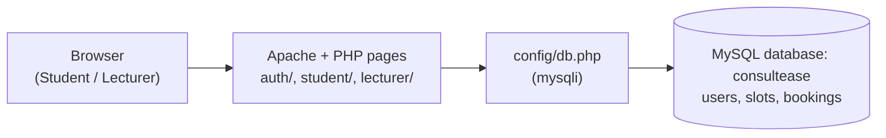
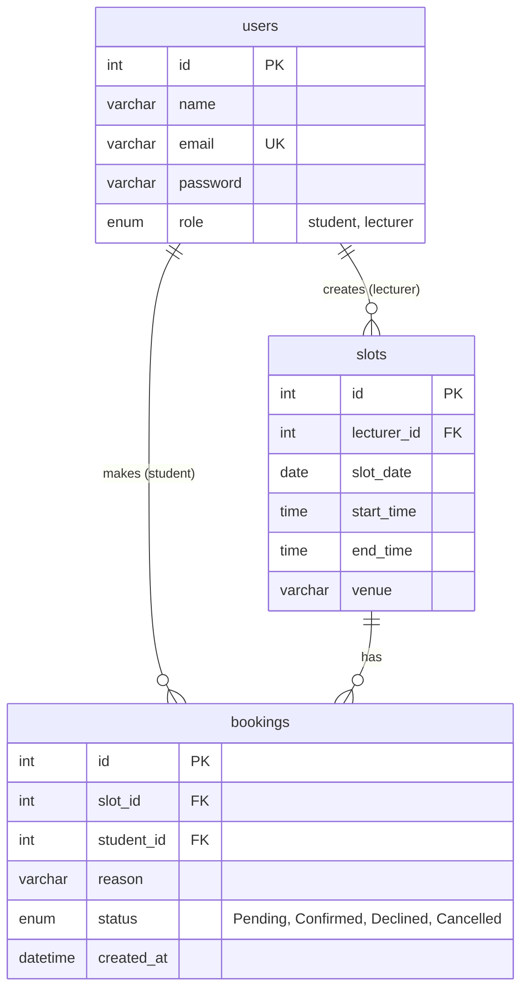

# ConsultEase

A lecturer consultation booking system built with plain PHP and MySQL.

## About

ConsultEase replaces informal consultation arrangements between students and lecturers with a simple booking system. Lecturers publish the consultation slots they are available for, and students browse the open slots and book one with a reason for the consultation. Every booking starts as **Pending** until the lecturer confirms or declines it, and students can follow the status of their bookings or cancel them. The system was built as a university group assignment.

**Team**

| Name | Role |
|---|---|
| Mohamad Amirul Ariff | Project Manager |
| Wan Nurain Syafiah | Developer |
| Syazwani | Developer / QA |

## Features

**All users**
- Log in with email and password; users are sent to the student or lecturer area based on their role
- Log out
- Role-based navigation bar; students cannot open lecturer pages and lecturers cannot open student pages

**Lecturer**
- Create consultation slots (date, start time, end time, venue)
- View, edit and delete their own slots
- View booking requests on their slots, including the student's reason
- Confirm or decline Pending booking requests

**Student**
- View upcoming available slots from all lecturers
- Book a slot with a reason for consultation; new bookings are Pending
- Double-booking prevention: a slot with a Pending or Confirmed booking cannot be booked again
- View their bookings and statuses (Pending, Confirmed, Declined, Cancelled)
- Cancel a Pending or Confirmed booking

**Security**
- Passwords hashed with `password_hash()` and checked with `password_verify()`
- Prepared statements for every query that uses user input
- Output escaped with `htmlspecialchars()`
- CSRF tokens on the forms that delete slots and change booking status

## System Architecture



Students and lecturers use the system through a web browser. Each request goes to a PHP page served by Apache: `auth/` handles login and logout, `student/` holds the student pages and `lecturer/` holds the lecturer pages. Every page includes `config/db.php`, which opens a mysqli connection to the `consultease` MySQL database, where the users, slots and bookings are stored. The pages render HTML with Bootstrap 5 through the shared `includes/header.php` and `includes/footer.php` layout.

## Database



- `slots.lecturer_id` references `users.id`
- `bookings.slot_id` references `slots.id`
- `bookings.student_id` references `users.id`
- All foreign keys use `ON DELETE CASCADE`

## Tech Stack

- **Backend:** PHP 8 (procedural, no framework)
- **Database:** MySQL / MariaDB with the `mysqli` extension
- **Web server:** Apache, via XAMPP
- **Frontend:** HTML and Bootstrap 5.3 (from CDN), plus `assets/css/style.css`
- **Tools:** Git and GitHub, Jira

## How to Run on XAMPP

1. Install [XAMPP](https://www.apachefriends.org/) if you don't have it.
2. Clone the project into `C:\xampp\htdocs`. Keep the folder name `ConsultEase`, because the app's links use `/ConsultEase/`.
   ```
   cd C:\xampp\htdocs
   git clone https://github.com/AreCika/ConsultEase.git
   ```
3. Open the **XAMPP Control Panel** and click **Start** for **Apache** and **MySQL**.
4. Open phpMyAdmin at http://localhost/phpmyadmin, go to the **Import** tab, choose `database.sql` from the project folder, and click **Import** (or **Go**). This creates the `consultease` database, its tables and the sample accounts.
   > Importing `database.sql` again deletes and recreates the database, so any slots and bookings you added are lost.
5. Open http://localhost/ConsultEase/ in your browser and log in with one of the sample accounts below.

The database settings are in `config/db.php` and use the XAMPP defaults (user `root`, no password).

## Sample Login Accounts

| Role | Name | Email | Password |
|---|---|---|---|
| Lecturer | Dr. Siti Aminah | `lecturer@consultease.test` | `lecturer123` |
| Student | Ali Hassan | `student1@consultease.test` | `student123` |
| Student | Mei Ling Tan | `student2@consultease.test` | `student123` |

Tip: to test as a lecturer and a student at the same time, use a normal window for one and a private/incognito window for the other.

## Folder Structure

```
ConsultEase/
├── index.php                      Home page
├── database.sql                   Creates the database, tables and sample users
├── config/
│   └── db.php                     Database connection and BASE_URL
├── includes/
│   ├── header.php                 Shared layout: page head and navbar
│   └── footer.php                 Shared layout: footer and scripts
├── assets/
│   └── css/
│       └── style.css              Custom styles on top of Bootstrap
├── auth/
│   ├── login.php                  Login form
│   └── logout.php                 Ends the session
├── lecturer/
│   ├── list_slots.php             Lecturer's slots (edit / delete)
│   ├── create_slot.php            Create a slot
│   ├── edit_slot.php              Edit a slot
│   ├── delete_slot.php            Deletes a slot (form handler)
│   ├── booking_requests.php       Booking requests (confirm / decline)
│   └── update_booking_status.php  Confirms or declines a booking (form handler)
├── student/
│   ├── available_slots.php        Student dashboard: available slots
│   ├── book_slot.php              Book a slot
│   ├── my_bookings.php            Student's bookings (cancel)
│   └── cancel_booking.php         Cancels a booking (form handler)
└── docs/
    └── ConsultEase UI Mockup.pdf  UI mockup used for the design
```

## Out of Scope

These are not part of this version:

- Self-registration (accounts are created in `database.sql`)
- Mobile layout (the system is designed for desktop browsers)
- Email notifications

## Project Management

Tasks were planned and tracked in Jira: https://consultease.atlassian.net

Each commit message starts with its Jira issue key, for example `KAN-34 Add available slots page for students`.
